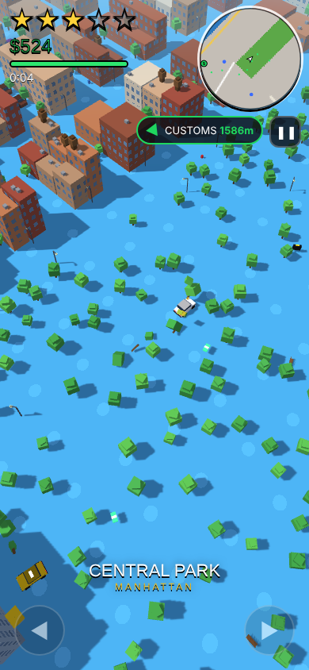
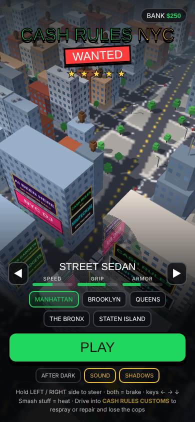
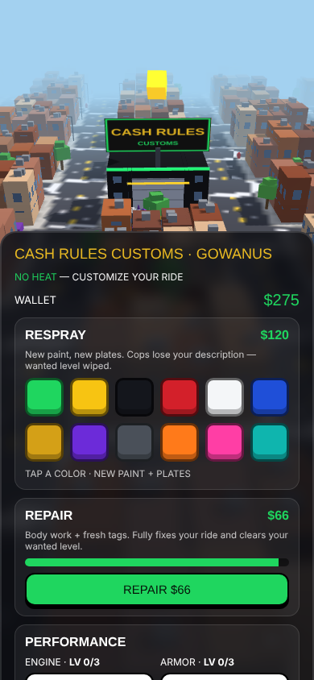
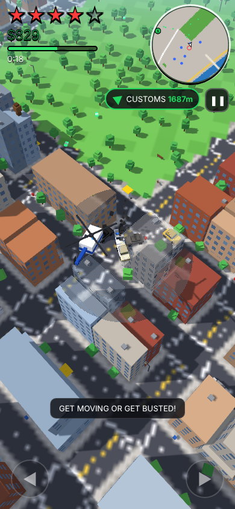
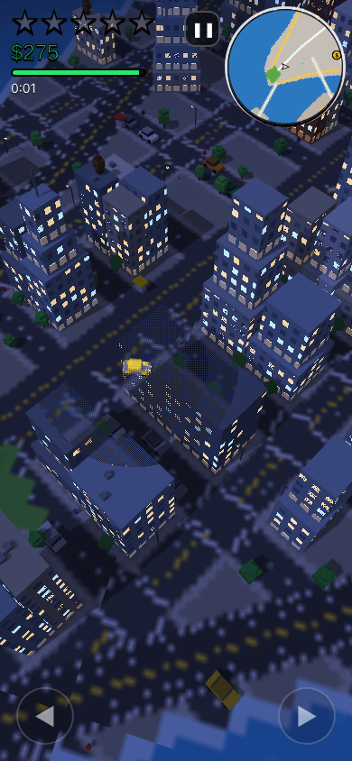
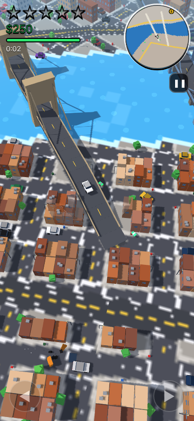
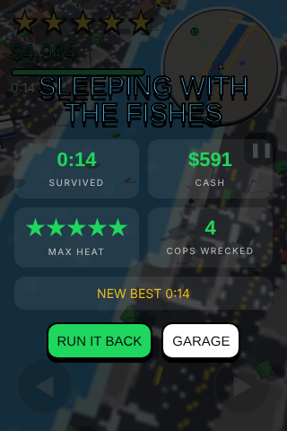

# CASH RULES NYC: WANTED ★★★★★

A blocky, Smashy Road–style police chase across the **real map of all five NYC boroughs**. Smash through the city, stack up wanted stars, and when the heat gets too hot, slide into a **Cash Rules Customs** garage to respray or repair your ride and wipe your wanted level, Pay 'n' Spray style.



## Features
- Manhattan, Brooklyn, Queens, the Bronx and Staten Island, plus the Jersey waterfront. Real coastlines, rivers and bays.
- 25 bridges: Brooklyn, Manhattan, Williamsburg, Queensboro, RFK, GWB, Verrazzano, Whitestone, Throgs Neck, Bayonne, Goethals and more. Also the FDR, West Side Hwy, BQE, Belt, LIE, Cross Bronx and other highways.
- Landmarks: Times Square billboards, Empire State, One WTC, Chrysler, Statue of Liberty, Yankee Stadium, Citi Field, Barclays, Coney Island, the Unisphere, JFK/LGA, and the Staten Island Ferry.
- 1–5 wanted stars: NYPD cruisers, then ESU SUVs, then ESU heavies and a helicopter. You end a run WASTED, BUSTED, or sleeping with the fishes.
- 17 **Cash Rules Customs** shops in real auto-repair areas (Willets Point, Jerome Ave, Hell's Kitchen, Gowanus, Hunts Point…). Respray or repair to lose the cops, and buy engine and armor upgrades. The door won't open while a cop is on your bumper.
- 5 unlockable rides: Street Sedan, Yellow Cab, Electric Crossover, Muscle Coupe, Box Truck.
- After Dark night mode, a rotating minimap and full map, and progress that saves on the device.

## Controls
| | Phone | Keyboard |
|---|---|---|
| Steer | Hold the left or right half of the screen | ← → / A D |
| Brake / reverse | Hold both halves | ↓ / S / Space |
| Pause + map | Tap the minimap or ❚❚ | P / Esc / M |

## Develop
```bash
python3 build.py                      # src/ -> dist/index.html (single file)
python3 -m http.server 8080 -d dist   # play at http://localhost:8080
node test/maptest.js                  # map render check -> test/out/
```
See **CLAUDE.md** for the architecture, conventions, tuning knobs and test harness.

## Deploy (Netlify)
Connect this repo in Netlify. `netlify.toml` already sets build `python3 build.py` and publish `dist`. Or drag the `dist/` folder onto Netlify Drop.

## Screenshots
| | | |
|---|---|---|
|  |  |  |
|  |  |  |

© CASH RULES NYC LLC. Original code and art. Inspired by the arcade chase genre; contains no third-party game code or assets.
